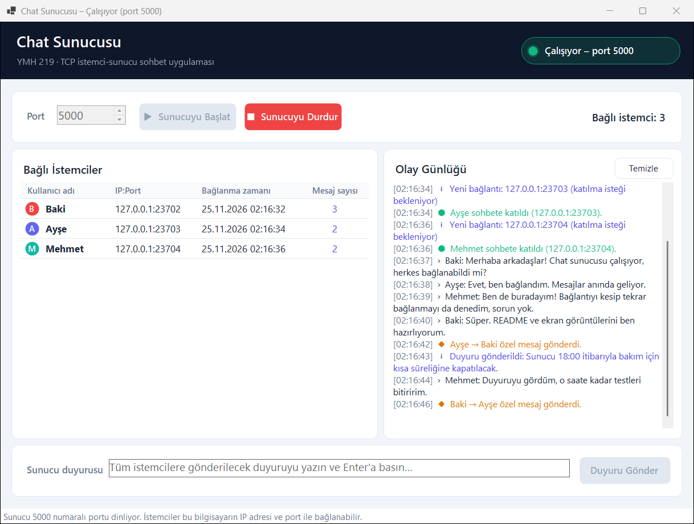
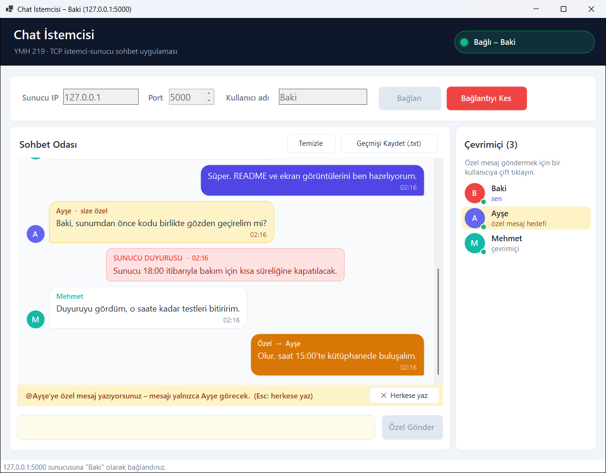

# YMH219 - Chat App (İstemci-Sunucu Sohbet Uygulaması)

TCP/IP üzerinde çalışan, Windows Forms ile geliştirilmiş bir istemci-sunucu sohbet sistemi. **Sunucu** uygulaması bağlanan istemcileri kabul eder, listeler ve mesajları dağıtır. **İstemci** uygulaması kullanıcı adıyla sunucuya bağlanır; herkese açık mesaj, kullanıcıya özel mesaj gönderebilir ve sohbet geçmişini `.txt` dosyasına kaydedebilir. Aynı bilgisayarda veya aynı yerel ağdaki farklı bilgisayarlarda çalışır.

Bu proje, YMH 219 Nesne Tabanlı Programlama dersi ek uygulama ödevlerinin **5. ödevidir**.

## Kullanılan Teknolojiler

| Teknoloji | Açıklama |
|---|---|
| C# | Programlama dili |
| .NET 8 (`net8.0-windows`) | Hedef çatı |
| Windows Forms | Sunucu ve istemci arayüzleri |
| `TcpListener` / `TcpClient` (`System.Net.Sockets`) | TCP bağlantıları |
| `StreamReader` / `StreamWriter` (UTF-8) | Satır tabanlı mesaj okuma/yazma |
| `System.Text.Json` | Mesajların tek satır JSON'a dönüştürülmesi |
| `async/await`, `CancellationToken`, `SemaphoreSlim` | Asenkron kabul/dinleme döngüleri, düzgün kapanış, güvenli yazma |
| GDI+ (`System.Drawing`) | Mesaj baloncukları, avatarlar, yuvarlak butonlar ve durum rozetlerinin çizimi |
| Visual Studio 2022 / 2026 | Geliştirme ortamı |

Harici NuGet paketi kullanılmamıştır; her şey .NET'in kendi kütüphaneleriyle yazılmıştır.

## Mimari

Çözüm üç projeden oluşur:

```
YMH219-ChatApp/
├── YMH219-ChatApp.sln
├── README.md
├── screenshots/
├── ChatApp.Shared/                    # Ortak kütüphane (sunucu ve istemci kullanır)
│   ├── Protocol/
│   │   ├── MessageType.cs             # Mesaj türleri (enum)
│   │   ├── ChatMessage.cs             # Mesaj modeli: Tür, Gönderen, Alıcı, İçerik, Zaman
│   │   └── MessageSerializer.cs       # ChatMessage <-> tek satır JSON
│   ├── ChatConstants.cs               # Varsayılan port (5000), sınırlar, zaman aşımları
│   ├── UserNameValidator.cs           # Kullanıcı adı kuralları
│   └── UI/                            # Ortak görsel bileşenler
│       ├── Theme.cs                   # Renkler, avatar ve yuvarlak köşe çizimi
│       ├── ModernButton.cs            # Yuvarlak köşeli buton
│       ├── CardPanel.cs               # Kart görünümlü panel
│       └── StatusBadge.cs             # Renkli durum göstergesi
├── ChatApp.Server/                    # Sunucu uygulaması
│   ├── Network/
│   │   ├── ChatServer.cs              # TcpListener, kabul döngüsü, yayın, özel mesaj, kapanış
│   │   ├── ClientConnection.cs        # Tek istemci: soket, akışlar, bilgiler, okuma döngüsü
│   │   └── ServerLogEventArgs.cs      # Günlük kaydı (zaman, tür, metin)
│   ├── MainForm.cs / .Designer.cs     # Sunucu penceresi
│   └── Program.cs
└── ChatApp.Client/                    # İstemci uygulaması
    ├── Network/
    │   ├── ChatClient.cs              # Bağlan, gönder, bağlantıyı kes, async dinleme, olaylar
    │   ├── ChatClientException.cs     # Kullanıcıya gösterilecek hata
    │   └── DisconnectedEventArgs.cs   # Bağlantı bitiş nedeni
    ├── Services/
    │   ├── HistoryService.cs          # Sohbet geçmişini .txt'ye kaydetme
    │   └── TurkishText.cs             # "Ali'ye", "Mehmet'e" gibi Türkçe ekler
    ├── Controls/
    │   ├── ChatView.cs                # Baloncuklu sohbet alanı (owner-draw)
    │   └── UserListBox.cs             # Avatarlı çevrimiçi kullanıcı listesi
    ├── MainForm.cs / .Designer.cs     # İstemci penceresi
    └── Program.cs
```

| Sınıf | Sorumluluk |
|---|---|
| `ChatServer` | Belirtilen portu `IPAddress.Any` üzerinde dinler, her istemciyi ayrı bir görevde işler. Katılma isteğini doğrular, aynı kullanıcı adını reddeder, mesajları herkese/özel olarak iletir. İstemci listesi kilitle (`lock`) korunur. `Log`, `ClientJoined`, `ClientLeft`, `ClientUpdated` olaylarıyla arayüzü bilgilendirir. |
| `ClientConnection` | Sunucu tarafında tek bir istemci: `TcpClient`, `StreamReader/StreamWriter`, kullanıcı adı, IP:port, bağlanma zamanı, mesaj sayısı. `SendAsync` (yazma kilidiyle) ve `ReadLoopAsync` sağlar. `IDisposable`. |
| `ChatClient` | İstemci tarafı ağ katmanı: `ConnectAsync`, `SendChatAsync`, `SendPrivateAsync`, `DisconnectAsync`. Dinleme döngüsü arka planda çalışır; `MessageReceived`, `UserListChanged`, `Disconnected` olaylarını yayınlar. Soket hatalarını anlaşılır Türkçe mesajlara çevirir. |
| `HistoryService` | Ekranda gösterilen mesajları tutar, zaman damgalı UTF-8 metin dosyasına yazar. |
| `ChatMessage` / `MessageSerializer` | Ortak protokol modeli ve JSON dönüşümü. |
| `MainForm` (her iki uygulama) | Yalnızca arayüz: kullanıcı etkileşimini alır, ağ sınıflarını çağırır. Arka plan iş parçacığından gelen olaylar `BeginInvoke` ile arayüz iş parçacığına aktarılır; formun içinde ağ kodu yoktur. |

### Mesaj Protokolü

Her mesaj, sonunda satır sonu olan **tek satırlık bir JSON** nesnesidir (`StreamReader.ReadLine` ile mesaj mesaj okunur). Örnek:

```json
{"type":"Chat","sender":"Ayşe","content":"Merhaba!","timestamp":"2026-11-25T14:03:12+03:00"}
```

| Tür | Yön | Alanlar | Açıklama |
|---|---|---|---|
| `Join` | İstemci → Sunucu | `sender` | Bağlandıktan sonraki ilk mesaj; kullanıcı adıyla katılma isteği |
| `JoinAccepted` | Sunucu → İstemci | `recipient`, `content` | Katılma kabul edildi, karşılama mesajı |
| `JoinRejected` | Sunucu → İstemci | `content` | Katılma reddedildi (ad kullanımda, boş, geçersiz); ardından bağlantı kapanır |
| `Chat` | İki yönlü | `sender`, `content` | Herkese açık mesaj; sunucu herkese (gönderen dahil) iletir |
| `Private` | İki yönlü | `sender`, `recipient`, `content` | Özel mesaj; yalnızca alıcıya ve gönderene iletilir |
| `UserList` | Sunucu → İstemci | `users` | Çevrimiçi kullanıcı adları (her katılma/ayrılmada) |
| `System` | Sunucu → İstemci | `content` (`recipient:"*"` ise duyuru) | "Ali sohbete katıldı" gibi bildirimler ve sunucu duyuruları |
| `Leave` | İki yönlü | `sender`, `content` | İstemci ayrılıyor / sunucu kapanıyor (sebep `content`'te) |

Güvenlik için gönderen adı ve zaman **sunucuda** belirlenir; bir istemci başka bir kullanıcı adına mesaj yazamaz. Bozuk JSON satırları atlanır, bağlantı düşürülmez.

## Kurulum ve Çalıştırma

### Gereksinimler
- Windows 10 / 11
- [.NET 8 SDK](https://dotnet.microsoft.com/download/dotnet/8.0) veya daha yeni bir SDK
- Visual Studio 2022 (17.8+) veya Visual Studio 2026, **.NET masaüstü geliştirme** iş yüküyle

> Projeler `RollForward=Major` ayarına sahiptir. Bilgisayarda .NET 8 çalışma zamanı yoksa daha yeni bir .NET masaüstü çalışma zamanında (ör. .NET 10) da çalışır.

### Visual Studio ile
1. Depoyu klonlayın:
   ```bash
   git clone https://github.com/bakibasbay/YMH219-ChatApp.git
   ```
2. `YMH219-ChatApp.sln` dosyasını Visual Studio ile açın ve **Derle > Çözümü Derle** (`Ctrl+Shift+B`) ile derleyin.
3. Önce sunucuyu başlatın: `ChatApp.Server` projesine sağ tıklayın > **Hata Ayıkla > Yeni Örnek Başlat**.
4. Sonra istemcileri başlatın: `ChatApp.Client` projesinde aynı işlemi **birden fazla kez** yapın (her biri ayrı bir kullanıcı).

> İsterseniz çözüme sağ tıklayıp **Başlangıç Projelerini Yapılandır > Birden çok başlangıç projesi** ile Server ve Client'ı birlikte başlatabilirsiniz.

### Komut satırı ile
```bash
cd YMH219-ChatApp
dotnet build
dotnet run --project ChatApp.Server        # 1. terminal
dotnet run --project ChatApp.Client        # 2. terminal (istemci 1)
dotnet run --project ChatApp.Client        # 3. terminal (istemci 2)
```
Derlenmiş dosyalar doğrudan da çalıştırılabilir: `ChatApp.Server\bin\Debug\net8.0-windows\ChatApp.Server.exe` ve `ChatApp.Client\bin\Debug\net8.0-windows\ChatApp.Client.exe` (istemci exe'si birden fazla kez açılabilir).

### Kullanım
1. **Sunucu** penceresinde portu seçin (varsayılan **5000**) ve **▶ Sunucuyu Başlat**'a tıklayın. Durum göstergesi yeşil *Çalışıyor – port 5000* olur; olay günlüğünde bu bilgisayarın yerel ağ IP adresleri yazılır.
2. **İstemci** penceresinde *Sunucu IP* (aynı bilgisayar için `127.0.0.1`), *Port* ve *Kullanıcı adı* girip **Bağlan**'a tıklayın (veya kullanıcı adı kutusunda Enter).
3. Mesajı yazıp **Gönder**'e tıklayın veya **Enter**'a basın.
4. **Özel mesaj:** sağdaki *Çevrimiçi* listesinde bir kullanıcıya **çift tıklayın** (veya seçip Enter). Mesaj kutusu turuncuya döner ve "@Ayşe'ye özel mesaj yazıyorsunuz" bandı görünür. **Esc** veya **✕ Herkese yaz** ile normal moda dönülür.
5. **Geçmişi Kaydet (.txt)** ile sohbet geçmişini metin dosyasına kaydedin.
6. **Bağlantıyı Kes** ile sohbetten ayrılın. Sunucuda **■ Sunucuyu Durdur** tüm istemcilere "Sunucu kapatıldı" bildirimi gönderir.

### Aynı ağdaki başka bir bilgisayardan bağlanma
1. Sunucuyu çalıştıran bilgisayarda olay günlüğünde yazan IP adresini (ör. `192.168.1.20`) not edin. (Alternatif: `ipconfig` komutundaki *IPv4 Adresi*.)
2. Diğer bilgisayardaki istemcide *Sunucu IP* alanına bu adresi, *Port* alanına sunucudaki portu yazıp bağlanın.
3. **Windows Güvenlik Duvarı:** Sunucu ilk kez başlatıldığında Windows *"Ortak ve özel ağların bu uygulamaya erişmesine izin vermek istiyor musunuz?"* diye sorar. Diğer bilgisayarların bağlanabilmesi için **İzin ver** seçilmelidir (en azından *Özel ağlar*). İptal edilirse yalnızca aynı bilgisayardan (`127.0.0.1`) bağlanılabilir. Bu seçim sonradan *Windows Güvenlik Duvarı > Bir uygulamaya veya özelliğe izin ver* bölümünden değiştirilebilir.
4. Ağ profili *Ortak* ise veya kurum/okul ağı istemciler arası trafiği engelliyorsa bağlantı kurulamayabilir; bu durumda istemci zaman aşımı mesajı gösterir.

## Özellikler

**Sunucu**
- Port seçimi, **Sunucuyu Başlat / Durdur**, renkli durum göstergesi (yeşil *Çalışıyor – port 5000* / kırmızı *Durdu*)
- **Bağlı istemciler listesi:** kullanıcı adı (avatarlı), IP:Port, bağlanma zamanı, mesaj sayısı (canlı güncellenir) ve toplam bağlı istemci sayısı
- **Olay günlüğü:** bağlanma, katılma, ayrılma, mesajlar, özel mesaj bildirimleri (içerik yazılmaz), uyarılar ve hatalar; zaman damgalı ve türüne göre renkli
- **Sunucu duyurusu:** tüm istemcilere duyuru gönderme (istemcide kırmızı kutu olarak görünür)
- Aynı kullanıcı adıyla ikinci bağlantıyı (büyük/küçük harf duyarsız) ve boş/geçersiz adları reddetme
- Port kullanımdaysa anlaşılır hata; durdurulurken istemcilere bildirim, `CancellationToken` ile döngülerin iptali ve kaynakların kapatılması; pencere kapanırken sunucunun düzgün durdurulması

**İstemci**
- Sunucu IP (varsayılan `127.0.0.1`), port, kullanıcı adı; **Bağlan / Bağlantıyı Kes**; renkli bağlantı durumu (*Bağlı değil* kırmızı, *Bağlanıyor…* yanıp sönen turuncu, *Bağlı – Ad* yeşil)
- **Baloncuklu sohbet:** kendi mesajları sağda mavi, diğerleri solda beyaz (gönderen adı ve renkli avatarla), her mesajda saat; sistem mesajları ortada gri ("Ali sohbete katıldı"); duyurular kırmızı
- **Çevrimiçi kullanıcılar listesi** (kendi adı "sen" etiketiyle en üstte); çift tıklayınca **özel mesaj modu**; özel mesajlar turuncu tonlarında ("Özel → Ayşe", "Ali · size özel")
- Enter ile gönderme; bağlı değilken mesaj kutusu ve Gönder butonu pasif
- **Sohbet geçmişini .txt'ye kaydetme** (zaman damgalı, UTF-8) ve ekranı temizleme
- **Hata yönetimi:** sunucu yok, yanlış IP/port, zaman aşımı, kullanıcı adı reddi, sunucunun kapanması veya bağlantının kopması durumunda uygulama çökmez; `MessageBox` ve durum çubuğuyla bildirir ve "Bağlı değil" durumuna döner
- Her iki uygulamada beklenmeyen hatalar genel yakalayıcıyla gösterilir, uygulama kapanmaz

## Ekran Görüntüleri

### Sunucu: bağlı istemciler (IP:Port, bağlanma zamanı, mesaj sayısı) ve olay günlüğü


### İstemci: mesaj baloncukları, sunucu duyurusu, özel mesajlar ve çevrimiçi kullanıcılar


## Yapılan Testler

- Ham TCP ile protokol: katılma, aynı ad (`ali` / `Ali`) ve boş ad reddi, `Join` göndermeden mesaj atan bağlantının kapatılması, gönderen adının sunucuda düzeltilmesi, özel mesajın yalnızca iki tarafa gitmesi, çevrimiçi olmayan kişiye özel mesaj uyarısı, bozuk JSON satırının atlanması, 1000 karakter sınırı, ayrılma bildirimi.
- Arayüz (UI Automation ile): üç istemci (Baki, Ayşe, Mehmet) aynı odada; herkese açık mesaj, özel mesaj, sunucu duyurusu; sunucu kapalıyken bağlanma, geçersiz adres, boş kullanıcı adı, aynı kullanıcı adı, sunucunun durdurulması, sunucu sürecinin aniden kapatılması, aynı portta ikinci sunucu ve geçmiş dosyasının kaydedilmesi.

## Bilinen Sınırlamalar / Geliştirme Notları

- Tek bir ortak sohbet odası vardır; birden fazla oda/kanal desteklenmez.
- Mesajlar **şifrelenmez** (düz TCP + JSON). Yalnızca güvenilir yerel ağda kullanılmalıdır; kimlik doğrulama (parola) yoktur, kullanıcı adı yalnızca oturum boyunca benzersizdir.
- Sunucu mesajları saklamaz; sonradan katılan kullanıcı önceki mesajları göremez. Geçmiş yalnızca istemci tarafında, kullanıcı kaydederse dosyaya yazılır.
- Kalp atışı (heartbeat) mekanizması yoktur. Ağ kablosu çekilmesi gibi sessiz kopmalarda bağlantının koptuğu, işletim sistemi TCP zaman aşımına veya bir sonraki gönderime kadar fark edilmeyebilir.
- Bağlantı koptuğunda otomatik yeniden bağlanma yapılmaz; kullanıcı **Bağlan** ile tekrar bağlanır.
- Mesaj uzunluğu 1000, kullanıcı adı 20 karakterle sınırlıdır; kullanıcı adında boşluk kullanılamaz.
- Saatler her bilgisayarın yerel saatine göre gösterilir (zaman damgası sunucuda atanır).
- Olası geliştirmeler: birden fazla oda, TLS ile şifreleme, son mesajların sunucuda saklanması, "yazıyor…" göstergesi, dosya/emoji gönderimi.

## Öğrenci

**Muhammed Baki Başbay** – 250541016

YMH 219 Nesne Tabanlı Programlama – Ek Uygulama Ödevleri
